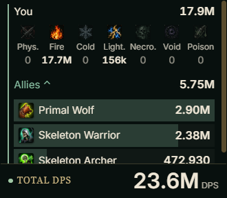
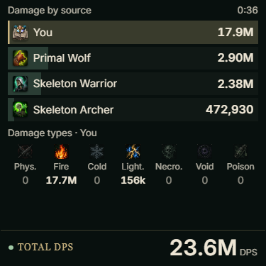
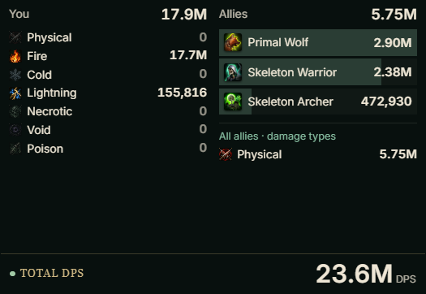
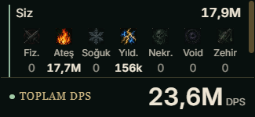
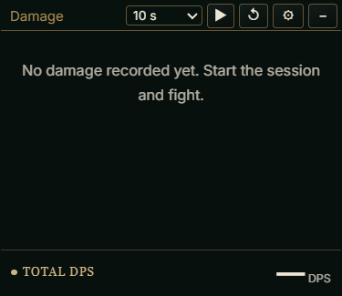
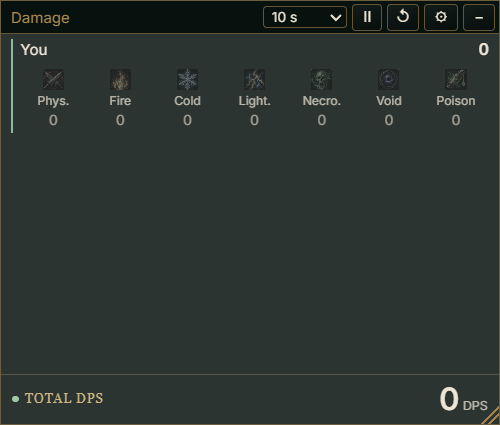
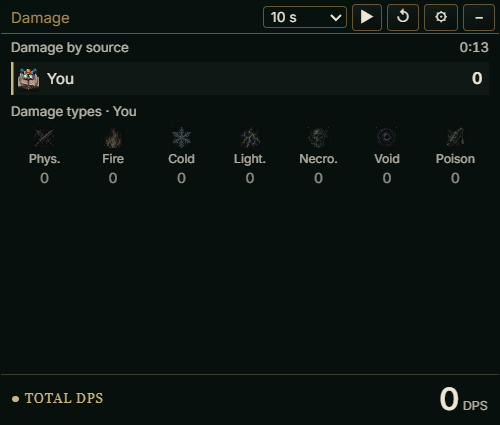
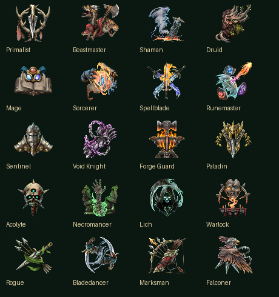
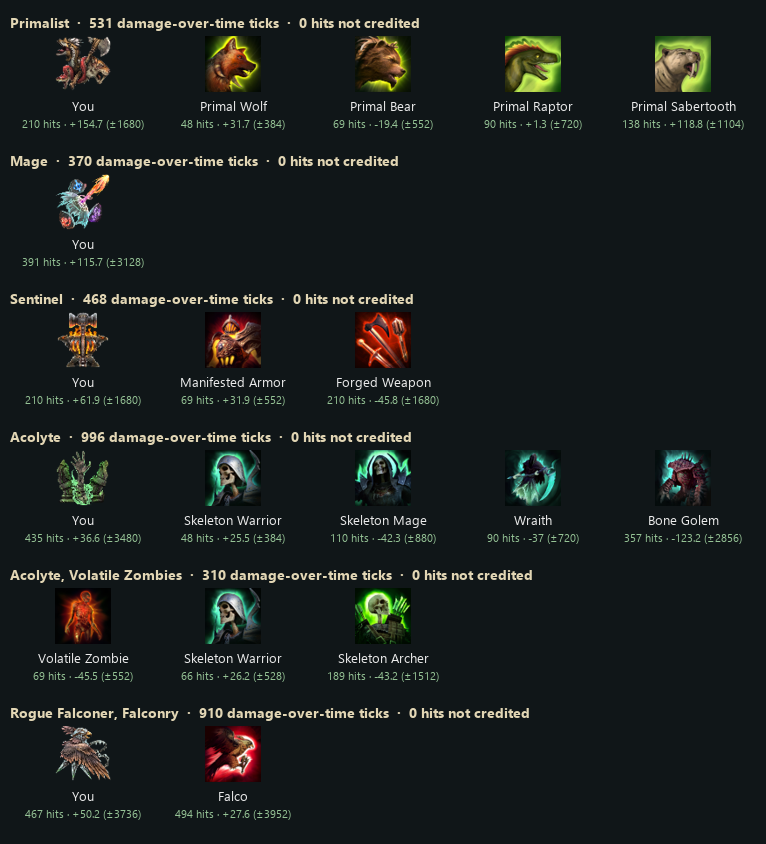

# DPS meter styles in the damage window (2026-10-15)

The three compact designs from the [design handoff](dps-meter-design-handoff-2026-10-15/CLAUDE-HANDOFF.md)
are styles of EpochPact's existing damage window, next to the full table. The owner chose
**Quiet HUD** as the default and **the game's own icons** for sources, then asked for: accuracy
checked with large numbers, simple ally names (which skeleton is which), the real package tested
without skipping its checks, and dragging and resizing tried by hand; then: no limits on the
tests, so damage over time and every class were measured too. That work found and fixed one real
gap (damage of short-lived allies and ailments of allies that died; see "A gap found and fixed").
Preview, real window, real package and live game results are reported separately.

## What changed

| Part | Change |
|---|---|
| `ui/damage-styles.js` (new) | `model()` (numbers for one averaging window), `html()` (draws a style once), `update()` (changes only numbers, bars, selection), `totalHtml()` |
| `ui/damage.html`, `ui/damage.js` | ⚙ → **Style** (Quiet HUD, Pact Bars, Split Meter, Table); averaging window selector in the bar (10 s, 60 s, 10 min, 60 min, Session, Combat); ▶/Ⅱ and ↺ icon buttons with titles; total footer outside the scrolling part; source selection; icon reads. Same transport, one-second read, busy guard, options key (`epochpact.damage-window.v1`, old options kept), frameless window, drag, grip, ⚙ and − |
| `ui/damage-meter.js` | Ally names: the game's own name when the core reports one, else the object name made readable ("SummonedSkeletonArcher" → "Summoned Skeleton Archer"); used by the table, the CSV, the Rows choices and the Summons page; game names are not translated. Hidden rows stay keyed by the object name, so saved choices keep working |
| `ui/style.css` | Scoped `.dm*` rules in `em`, using the window's background, text colour, text size, row spacing and top bar options; thin scrollbar in the window's content |
| `ui/assets/damage-types.png` (new) | The handoff atlas's seven damage-type tiles cut into one 448×64 strip (18 KB) |
| `native/core/convenience.cpp` | Each damage source gets **a name** (`label`: the game's display name for the ally, as its health bar shows it — "Skeleton Warrior", "Skeleton Archer", "Primal Wolf", "Ballista") and **an icon key** (`a:<skill ID>` for the skill that summoned the ally or the picture the game's minion cards use; skills without a player skill ID get `a:_<n>`; `c:<class>:<mastery>` for You). New read-only command `damageicon <key>`: loads the sprite the way the skill bar does and returns a PNG of at most 64×64 (base64), cached; everything created is released |
| Catalog, bridge | `damage_icon` read control; keys validated (`a:[A-Za-z0-9_]{1,32}` or `c:<0-99>:<0-99>`) |
| `ui/i18n.js` | Fix: an attribute whose translation equals its English text ("Void" in Turkish) was written back forever (page hang). Now written only when it changes |
| Packaging | The new script and icon strip in `EpochPact.spec`, `tools/build_player.py`, `epochpact_ui.py` and `tools/verify_player_package.py` (the first check build missed them: the spec keeps its own list; `tools/test_ui_resources.py` now checks all four) |
| Texts | 27 new texts in Turkish and Russian |
| Damage session (player core) | An ally the session has not listed yet is listed at its first hit when its creator chain reaches the character; an ally that died stays in its type for a minute so its ailment ticks still count; `live` counts allies still alive |
| Test core only | Fixtures for the measurements below (`dummy-*`, `kill-others-<n>`, `ally-attack-<k>`, `player-skill-<id>`, `player-heal`, `player-state`, `near-enemy-level`, `ally-gather-<k>`, `class-abilities`, `damage-icon-probe`, uncredited-hit counts); not in the player core |

Calculation rules (from the handoff, all tested): TOTAL DPS = sum of every source's value for the
chosen window; the allies' aggregate is not added again; `live` (×4) is a count; type values in
canonical order; Session/Combat type values = type total ÷ that time (0 when the time is 0);
selection and hidden rows never change the total; a chosen damage type is labelled
"TOTAL DPS · Fire"; missing or broken values show "—"; game names escaped and not translated; a
note when `unsplitHits > 0`. Numbers: every digit below a million (472,930), three significant
digits above (2.90M, 17.9M, 236M, 1.25B), in the window's language (2,90M / 17,9M in TR/RU).

## Accuracy with large numbers (live game, test core)

Method: every enemy within 30 units of the character is a measuring target. Just before each hit
on one, its health is set to 2^28 (268,435,456), so it never dies and a float health is exact to
±8 per hit. The test core then compares, per damage source type, the damage the session recorded
for each hit with the health that hit actually removed. Damage was raised with EpochPact's own stat
editor (+3,000,000 % damage, spell and minion damage). Isolated EpFeedbackTest clone, Z52.

| Round | Source | Hits | Session recorded | Health actually lost | Difference | Largest hit |
|---|---|---:|---:|---:|---:|---:|
| 45 s | You | 295 | 777,193,466 | 777,193,600 | −134 (0.00002 %) | 6,611,820 |
| | Skeleton Warrior | 129 | 89,047,820 | 89,047,840 | −20 | 1,584,680 |
| | Skeleton Archer | 42 | 22,023,371 | 22,023,376 | −5 | 638,505 |
| | Primal Wolf | 160 | 96,797,445 | 96,797,488 | −43 | 1,283,783 |
| 30 s | You | 340 | 899,613,107 | 899,613,152 | −45 | 6,188,056 |
| | Skeleton Warrior | 135 | 96,711,561 | 96,711,536 | +25 | 1,406,518 |
| | Skeleton Archer | 31 | 17,730,058 | 17,730,048 | +10 | 998,311 |
| | Primal Wolf | 171 | 105,629,149 | 105,629,136 | +13 | 1,400,119 |

Every difference is inside the rounding of a float health (8 per hit, e.g. ±2,720 for 340 hits) and
the signs vary: no systematic error. The damage-type split adds up to each source's total in every
row. Earlier single-target rounds agreed the same way (3,976,838 recorded vs 3,976,832 lost on a
boss). Peak 10 s DPS in the recorded states: You 17.9M, Primal Wolf 2.90M, Skeleton Warrior 2.38M,
Skeleton Archer 473k, total 23.6M.

What the rounds also showed: a target whose health was raised only once is not reliable — the
game recalculates an enemy's maximum health (to 155 or 2,937 in two rounds), which is why health is
now set before every hit. Summons attack idle enemies only when told to (`ally-attack-<k>`); in a
normal fight they attack on their own (earlier rounds: 44/40/54 hits).

These are the session states recorded from the game in that round, drawn by the real damage page
in a real WebView2 window at those sizes, with the game's icons exported in the live run (a replay
of real data; the live chain itself is tested in the next section).

## Real player package, nothing skipped (live game, player core, real mouse)

`tools.build_player --layout onedir`, then the packaged `EpochPact.exe` with an isolated user
folder, against the real game:

1. The app reported "update required" (the installed mod was the released dev.32), then **its own
   installer** installed the player core: installed SHA-256 = the package's bundled core
   (`flavor: player`).
2. The app started the game offline; the isolated clone was loaded. All the app's checks passed:
   the session was read through the app (`ok: true`) — no check was skipped or changed.
3. The app opened the damage window itself (remembered as open), at 300×260, top bar always shown.
4. Real mouse input (Windows SendInput; every press first checked that the point is on the damage
   window, so nothing could land in the game or another program):

| Step | Result |
|---|---|
| Click ▶ | Session active in the game, You row with the Mage class icon |
| Drag by the top bar | Window moved exactly +250, +120 px; place saved (260, 176 logical = 325, 220 px at 125 %) |
| Drag the corner grip | Window grew exactly +125, +100 px; size saved (400×340) |
| Click ↺ | Session reset (elapsed time back to 3 s, still running) |
| ⚙ → Style → Pact Bars (click, ↓, Enter) | Style saved (`bars`) and shown |
| Click Ⅱ | Session stopped |
| Close EpochPact (as its X button) | The damage window closed with it and stayed remembered as open |
| Start EpochPact again | The window reopened by itself at the same place and size, in Pact Bars |
| Click − | Window hidden, remembered as closed (place and size kept) |

The first two runs found mistakes in the test script, not in EpochPact: Windows did not let the test
bring the game to the front (fixed with a key tap before `SetForegroundWindow`), and the button
positions were measured at 300 px and not shifted after the resize. Run 3 passed every step, and
run 4 repeated all of it. Run 5 repeated every step on the final package (player core
`3b361cc0…` with the damage-session fix, package `9d8f3da2…`, checked by
`tools.verify_player_package`, 24/24): all steps passed again, with the same moves and sizes.
After every run the 54 save and runtime files and the installed mod were restored byte for byte.

## Game icons and names (live game)

`damageicon`: You `c:1:0` (Mage, 64×51), Skeleton Warrior `a:_0` and Skeleton Archer `a:_1`
(distinct pictures; Summon Skeleton has no player skill ID), Primal Wolf `a:wo42`, Ballista
`a:ba1574`; 30–75 ms per read, second read identical, colours correct; unknown keys return
`png: null`, malformed keys are refused.

## Preview (fake data, headless Chrome, exact window sizes)

18 cases: three styles and the table; en/tr/ru; text size 10, 13 and 22 px; 260×120 up to
420×300; no session, no damage, error, player only, allies only, long and hostile names, 15
sources, unsplit hits, damage type filter, stopped, top bar always, 30 % background. In every case
the total footer is visible, there is no horizontal overflow and no NaN.

## Tests

| Suite | Result |
|---|---|
| `tools/test_damage_styles.cjs` (new) | 10/10: 962.4 DPS brief example, every metric incl. zero denominators, selection/hidden invariance, damage-type filter, missing aggregate, malformed data, escaping, game names, number formats (en/tr/ru, million/billion boundaries), layout keys |
| `tools/test_damage_meter.cjs` | game names in rows, Rows choices, CSV and table; hidden rows keyed by object name |
| `tools/test_overlay_filters.cjs` | Quiet HUD default with old stored options, style/metric persistence, icons read once and a missing one at most three times |
| `tools/test_i18n.cjs` | no attribute rewrite loop |
| `tools/test_ui_resources.py` (new) | every file the pages load is packaged and served |
| All | JS 220/220, Python 330/330, native 21/21, texts tr 1614/1614 ru 1614/1614 |

## Damage over time and every class (live game, test core)

The first report left two gaps: damage over time was not measured, and only a Mage clone had been
used. Both are now measured in the game with the same per-hit method.

**Method.** For each class the isolated clone is turned into that class and a mastery before the
game starts (class and mastery in the clone only; the original class's skills and passives are
cleared, the owner's saves are untouched and the clone is removed afterwards). In Z52 the character
casts its own summons and class skills at the measuring targets; the stat editor gives the
character **and its minions 100 % chance to ignite, bleed and poison** on every hit; 40 s of
fighting, then 4 s for the last ticks.

**Damage over time is recorded.** Ailment ticks reach the meter through the same game function as
hits (the source object is the ailment, `ActiveAilment`), and are credited to whoever applied the
ailment, the character or the minion. In every class most measured hits were ticks.

Final player-core code (with the fix below), one 40 s fight per class:

| Class (mastery) | Ailment ticks | Direct hits | Source | Hits | Session recorded | Health actually lost | Difference | Float bound |
|---|---:|---:|---|---:|---:|---:|---:|---:|
| Primalist (Beastmaster) | 531 | 24 | You | 210 | 36,544,363 | 36,544,208 | +155 | ±1,680 |
| | | | Primal Wolf | 48 | 9,312,032 | 9,312,000 | +32 | ±384 |
| | | | Primal Bear | 69 | 33,799,949 | 33,799,968 | −19 | ±552 |
| | | | Primal Raptor | 90 | 30,308,849 | 30,308,848 | +1 | ±720 |
| | | | Primal Sabertooth | 138 | 33,258,599 | 33,258,480 | +119 | ±1,104 |
| Mage (Runemaster) | 370 | 21 | You | 391 | 88,934,676 | 88,934,560 | +116 | ±3,128 |
| Sentinel (Forge Guard) | 468 | 21 | You | 210 | 38,693,166 | 38,693,104 | +62 | ±1,680 |
| | | | Manifested Armor | 69 | 31,862,496 | 31,862,464 | +32 | ±552 |
| | | | Forged Weapon | 210 | 74,614,210 | 74,614,256 | −46 | ±1,680 |
| Acolyte (Necromancer) | 996 | 44 | You | 435 | 85,985,317 | 85,985,280 | +37 | ±3,480 |
| | | | Skeleton Warrior | 48 | 10,515,818 | 10,515,792 | +26 | ±384 |
| | | | Skeleton Mage | 110 | 25,492,278 | 25,492,320 | −42 | ±880 |
| | | | Wraith | 90 | 53,636,779 | 53,636,816 | −37 | ±720 |
| | | | Bone Golem | 357 | 153,236,709 | 153,236,832 | −123 | ±2,856 |
| Rogue (Falconer) | 273 | 24 | You | 297 | 70,403,412 | 70,403,536 | −124 | ±2,376 |
| Rogue (Falconer), Falconry on the bar | 910 | 51 | You | 467 | 101,147,442 | 101,147,392 | +50 | ±3,736 |
| | | | Falco (the Falconer's falcon) | 494 | 210,507,836 | 210,507,808 | +28 | ±3,952 |
| Acolyte, Volatile Zombies | 310 | 14 | Volatile Zombie | 69 | 33,079,203 | 33,079,248 | −46 | ±552 |
| | | | Skeleton Warrior | 66 | 15,673,514 | 15,673,488 | +26 | ±528 |
| | | | Skeleton Archer | 189 | 30,522,853 | 30,522,896 | −43 | ±1,512 |

The same fights with the released code earlier that day agreed the same way (Primalist You +47,
Wolf +20, Bear +12, Raptor −37, Sabertooth −35; Mage You +623 of ±5,264 over 658 hits; Sentinel
Forged Weapon −17; Acolyte Wraith +118, Bone Golem −2; Rogue You +121), and an Acolyte round with
960 ticks gave Skeleton Warrior +109 of ±1,104.

What the numbers show:

- Every difference is inside the float bound and the signs vary: no damage is lost, doubled or
  credited to the wrong source, for ticks or for hits, for the character or any minion.
- **Nothing escapes the meter:** between hits the test core also watches each target's health. In
  every class the health lost outside the damage function was **0**, so no damage over time or
  other damage reaches enemies by another route.
- The damage-type split adds up to each source's total in every row.
- The session also counts hits on enemies that were not measuring targets at that moment (further
  than 30 units when the targets were chosen): Sentinel 495 session hits, 489 on targets; Acolyte
  1,044 and 1,040. That is why You's session total can be larger; every hit on a target matches.
- Hits on targets not credited to any source: **0** in every class with the final code.

**A gap found and fixed: short-lived allies and ailments after death.** The test core also counts
every hit on a target that the session did *not* credit to a source, with the attacker. With
Volatile Zombies (they run in, explode and die) the released code missed damage:

| Acolyte, Volatile Zombies + Skeletons, 40 s | Released code | Fixed code |
|---|---:|---:|
| Hits on targets not credited to any source | **140** (31,023,897 damage) | **0** |
| Who | ignite/bleed/poison ticks of zombies that had already exploded | — |
| Session hits = hits measured on targets | no | yes (324 = 324) |

Cause: the session lists allies once a second and dropped an ally as soon as it died, so ailments
it had applied kept ticking in the name of an attacker the session no longer knew (and an ally that
hit and died within the same second was never listed). Fix (player core): an attacker the session
does not know is checked by its creator chain (`Actor.summoned → references → creator`, field reads
only) and listed at its first hit when the chain reaches the character or a listed ally; an ally
that died stays in its type for a minute (at most 512 kept), so its ailment ticks still count; the
**live** count shows only allies still alive. Volatile Zombie damage was shown about 38 % too low
before. All rows marked "fixed core" were measured with it.

**The Falconer's own falcon.** Falconry is the Falconer's mastery ability (`Mastery.masteryAbility`,
save ID `falc0`). With it on the clone's skill bar the game itself summons the falcon; the meter
shows it as **Falco** (its health-bar name) with the Falconry icon, and its hits and ailment ticks
match exactly (table above). Aerial Assault, Ballista and Decoy were used from the bar as the
player would. (The earlier "Storm Crow" came from casting another ability directly, not from the
Falconer.) Two test-tool artefacts, not EpochPact: Dive Bomb forced through the test fixture killed
the character, and the stat editor's raised maximum health does not refill current health (the test
now fills it before and during each fight).

**Every class's own identity.** You's icon key is the class and mastery of the loaded character in
every class (`c:0:1`, `c:1:3`, `c:2:2`, `c:3:1`, `c:4:3`), and all twenty class and mastery
pictures export correctly:

**Every class's own summons, names and icons** (as recorded in those fights, with their accuracy):

Names are the game's display names (the health bar's name); the core reads the
`ActorDisplayInformation` name and uses the base name when a custom name is set. The probe compared
`displayName`, `baseDisplayName` and the label for every summon: Primal Wolf, Primal Bear, Primal
Raptor, Primal Sabertooth, Skeleton Warrior, Skeleton Mage, Wraith, Bone Golem, Manifested Armor,
Forged Weapon, Volatile Zombie, Falco (the Falconer's falcon) and Ballista; no custom names were
set, so display name, base name and label were the same in every case. Decoy (it lives only a few
seconds) was named "Decoy" by the session.

## The Ballista (measured 2026-10-16)

The first eight Ballista attempts failed because of the test fixtures, not EpochPact or the game:
the game's `Ability.CastAfterDelay(constructor, from, to, …)` takes a creation point and a target
point, and the fixtures passed a *direction* as the target point. The Ballista therefore stood at
the world origin (0, 0.15, 1), 89 units from the character, and forced bolts flew toward it. Melee,
area and player skills worked by accident because they act where they are created (on the enemy).
New test-only fixtures pass real points (`summon-where`, `summon-at-<id>`, `ally-shoot-<k>`,
`ally-aim-<k>`); the old ones are unchanged and carry a comment about this.

| Rogue, C30, 30 s each | Ballista hits | Session recorded | Health actually lost | Difference | Float bound | Uncredited |
|---|---:|---:|---:|---:|---:|---:|
| Bolt cast from the Ballista to the enemy | 15 | 25,427,415 | 25,427,408 | +7 | ±120 | 0 |
| Turret-style cast (the game's own from-transform cast) | 14 | 22,652,633 | 22,652,608 | +25 | ±112 | 0 |

Shown as "Ballista" with its icon; session hits = measured hits; no health lost outside the damage
function. In the second round the Ballista expired before the end and its damage stayed credited
(the one-minute keep from the fix above). Evidence: `research/live/ballista-fix1/`.

## Not measured

- **Decoy damage.** Decoy was summoned and listed (icon and name). Thrown by the test tools it still
  lands at the world origin (0, 0.15, 0), even with real cast points: its position comes from another
  step of the game's normal ability use. Enemies walked to it (its taunt works). When it was killed,
  4 hits (447,067 damage in all) were recorded under **You**, most likely its death explosion, which
  the game credits to the character; those enemies were outside the measuring area, so these hits
  were not checked one by one. No hit went uncredited and no health was lost outside the damage
  function in those rounds.
