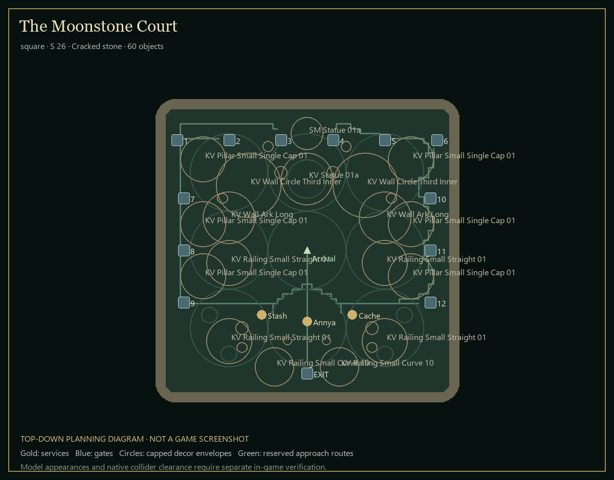
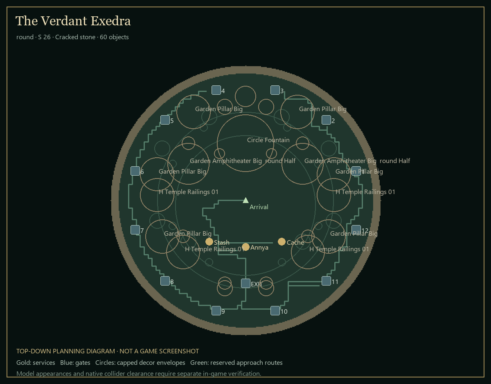
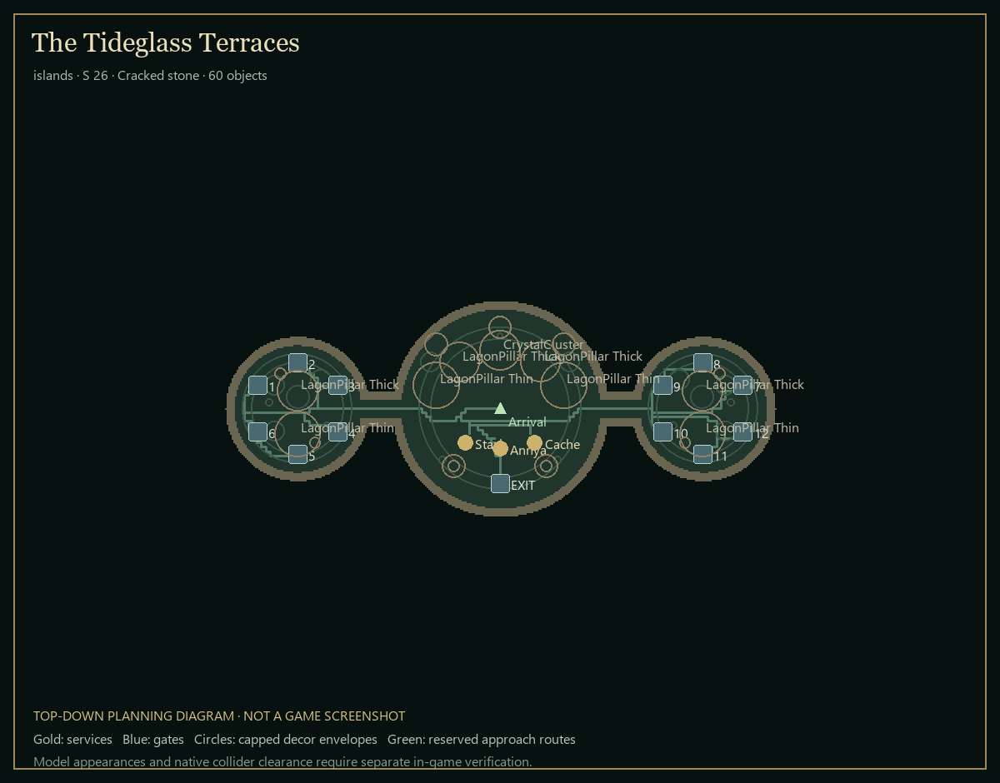
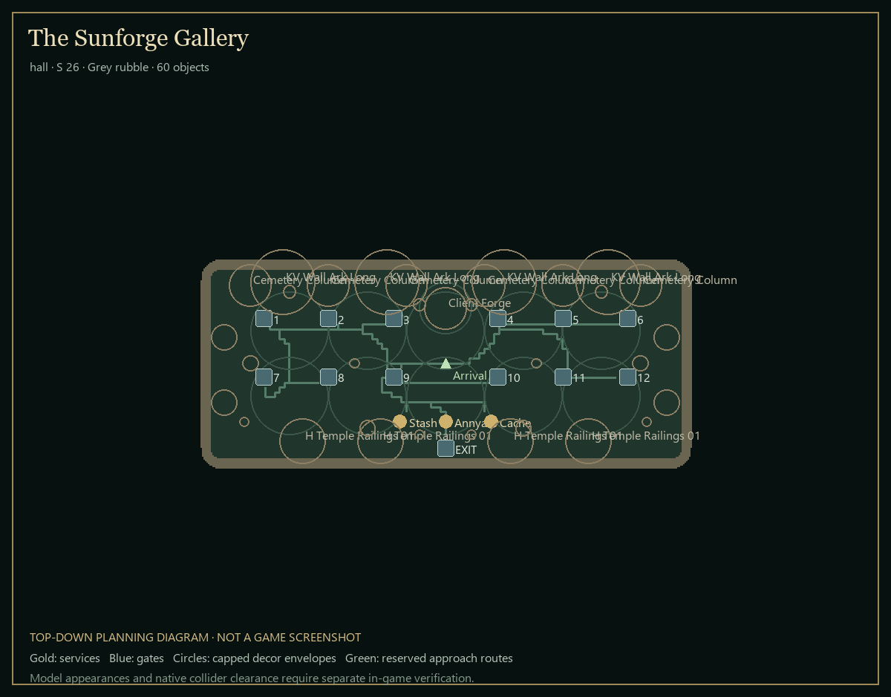
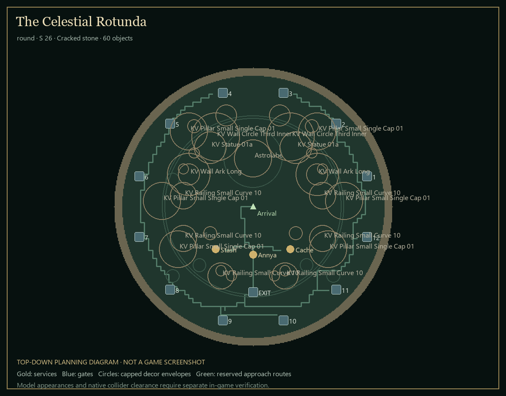

# Hideout designs and implementation

These diagrams are plans, not game screenshots. All model names and GUIDs come from the supplied catalog. The selected assets were inspected with the isolated Last Epoch 1.5.4 renderer; their measured bounds resolve the numeric scales in the exported tables. A successful thumbnail is not a guarantee that every catalog asset has finished textures, collision or a useful static pose.

The live system provides ten timeline bosses, Difficulty and Boss Rush (12 destinations), plus a protected return to the Hub. The design does not invent two extra boss encounters. Arrival is `(0, 0)`; the return gate is a separate object. Gameplay functionality is provided by the existing native stations, never decorative prefab scripts.

## Curated models

| Exact catalog name | Group | Reason | Appearance |
|---|---|---|---|
| CouncilChamberFloor_Eterra_01 | Floor | Gold-and-blue sun mosaic; a formal garden centre | Static thumbnail inspected in 1.5.4; individual materials/pose remain model dependent |
| KV_Floor_01_I | Floor | Violet marble paving with original UVs | Static thumbnail inspected in 1.5.4; individual materials/pose remain model dependent |
| KV_Floor_02_I | Floor | Matching violet marble variant | Static thumbnail inspected in 1.5.4; individual materials/pose remain model dependent |
| KV_Small_Circle_Floor_01 | Floor | Octagonal marble medallion and portal inset | Static thumbnail inspected in 1.5.4; individual materials/pose remain model dependent |
| KV_Floor_Circle_01 | Floor | Large violet rotunda floor with worn edges | Static thumbnail inspected in 1.5.4; individual materials/pose remain model dependent |
| Floor_01_I_Ang_18 | Floor | Carved pink ornamental floor | Static thumbnail inspected in 1.5.4; individual materials/pose remain model dependent |
| Floor_Stone_Circle | Floor | Subdued cobblestone court foundation | Static thumbnail inspected in 1.5.4; individual materials/pose remain model dependent |
| LagonFloor_Walkway | Floor | Blue-and-gold marine paving | Static thumbnail inspected in 1.5.4; individual materials/pose remain model dependent |
| Circle_Statue | Floor | Low concentric plinth for a portal court | Static thumbnail inspected in 1.5.4; individual materials/pose remain model dependent |
| Circle_Fountain | Monument | Real stepped fountain bowl; water effects not assumed | Static thumbnail inspected in 1.5.4; individual materials/pose remain model dependent |
| KV_Statue_01a | Monument | Violet guardian holding a gold orb | Static thumbnail inspected in 1.5.4; individual materials/pose remain model dependent |
| SM_Statue_01a | Monument | Small gold-and-black obelisk | Static thumbnail inspected in 1.5.4; individual materials/pose remain model dependent |
| Statue_Heroth_01 | Monument | Dark sculptural alternate landmark | Static thumbnail inspected in 1.5.4; individual materials/pose remain model dependent |
| Astrolabe | Monument | Brass-and-teal orrery; intentionally enlarged | Static thumbnail inspected in 1.5.4; individual materials/pose remain model dependent |
| KV_Pillar_Small_Single_Cap_01 | Architecture | Slender violet colonnade matching the marble court | Static thumbnail inspected in 1.5.4; individual materials/pose remain model dependent |
| KV_Pillar_Big_Bottom | Architecture | Large violet column for the rear skyline | Static thumbnail inspected in 1.5.4; individual materials/pose remain model dependent |
| KV_Pillar_Big_Base | Architecture | Matching round column base | Static thumbnail inspected in 1.5.4; individual materials/pose remain model dependent |
| KV_Wall_Ark_Long | Architecture | Violet double-arched rear wall | Static thumbnail inspected in 1.5.4; individual materials/pose remain model dependent |
| KV_Wall_Circle_Third | Architecture | Curved triple-arch gallery | Static thumbnail inspected in 1.5.4; individual materials/pose remain model dependent |
| KV_Wall_Circle_Third_Inner | Architecture | Vaulted apse enclosing a rear alcove | Static thumbnail inspected in 1.5.4; individual materials/pose remain model dependent |
| KV_Arc_Wall_01 | Architecture | Tall carved violet wall; keep at the rear | Static thumbnail inspected in 1.5.4; individual materials/pose remain model dependent |
| KV_Railing_Small_Straight_01 | Architecture | Low marble balustrade | Static thumbnail inspected in 1.5.4; individual materials/pose remain model dependent |
| KV_Railing_Small_Curve_10 | Architecture | Curved low rotunda railing | Static thumbnail inspected in 1.5.4; individual materials/pose remain model dependent |
| KV_Railing_10_Curve_30 | Architecture | Long curved balustrade alternate | Static thumbnail inspected in 1.5.4; individual materials/pose remain model dependent |
| Garden_Amphitheater_Big__round_Half | Architecture | Mossy half-round arched pergola | Static thumbnail inspected in 1.5.4; individual materials/pose remain model dependent |
| Garden_Pillar_Big | Architecture | Mossy garden colonnade | Static thumbnail inspected in 1.5.4; individual materials/pose remain model dependent |
| Garden_Wall_Straight_Arc_4m | Architecture | Garden stone arch alternate | Static thumbnail inspected in 1.5.4; individual materials/pose remain model dependent |
| H_Temple_Railings_01 | Architecture | Low gold-and-stone carved border | Static thumbnail inspected in 1.5.4; individual materials/pose remain model dependent |
| TOE_Railings_Turn_L1 | Architecture | Ornate green-and-gold corner | Static thumbnail inspected in 1.5.4; individual materials/pose remain model dependent |
| TOE_Railings_Turn_L2 | Architecture | Opposite corner for a paired entry | Static thumbnail inspected in 1.5.4; individual materials/pose remain model dependent |
| Cemetery_Column | Architecture | Warm carved column for the forge gallery | Static thumbnail inspected in 1.5.4; individual materials/pose remain model dependent |
| LagonPillar_Thick | Architecture | Blue-and-gold rope-bound temple column | Static thumbnail inspected in 1.5.4; individual materials/pose remain model dependent |
| LagonPillar_Thin | Architecture | Slender matching marine column | Static thumbnail inspected in 1.5.4; individual materials/pose remain model dependent |
| CrystalCluster | Crystal | Lilac multi-point crystal cluster; no emission assumed | Static thumbnail inspected in 1.5.4; individual materials/pose remain model dependent |
| SM_Bush_010_a | Nature | Compact green planting with readable scale | Static thumbnail inspected in 1.5.4; individual materials/pose remain model dependent |
| Grass_Flower_PinkWhite_Clump | Nature | Small pink-white flowering clump | Static thumbnail inspected in 1.5.4; individual materials/pose remain model dependent |
| Fern1Standard | Nature | Small fern alternate; not a large canopy | Static thumbnail inspected in 1.5.4; individual materials/pose remain model dependent |
| Eterra Vase 01 | Prop | Teal-and-orange ceramic accent | Static thumbnail inspected in 1.5.4; individual materials/pose remain model dependent |
| Eterra Vase 02 | Prop | Planted teal garden bowl | Static thumbnail inspected in 1.5.4; individual materials/pose remain model dependent |
| Eterra Vase 03 | Prop | Second planted teal bowl | Static thumbnail inspected in 1.5.4; individual materials/pose remain model dependent |
| Eterra Vase 04 | Prop | Tall teal urn | Static thumbnail inspected in 1.5.4; individual materials/pose remain model dependent |
| SM_Urn_01a | Prop | Embossed squat gold urn | Static thumbnail inspected in 1.5.4; individual materials/pose remain model dependent |
| SM_Urn_02a | Prop | Carved slender gold urn | Static thumbnail inspected in 1.5.4; individual materials/pose remain model dependent |
| SM_Urn_04a | Prop | Tall slim metallic urn | Static thumbnail inspected in 1.5.4; individual materials/pose remain model dependent |
| SM_Torch_01a | Prop | Dark bronze brazier; flame not assumed | Static thumbnail inspected in 1.5.4; individual materials/pose remain model dependent |
| Client_Forge | Workshop | Textured circular forge, the workshop landmark | Static thumbnail inspected in 1.5.4; individual materials/pose remain model dependent |
| Coral_16_G1_BlueVSPro | Marine | Blue finger coral provides compact colour | Static thumbnail inspected in 1.5.4; individual materials/pose remain model dependent |
| Coral_RedFlower_01 | Marine | Small warm coral rosette | Static thumbnail inspected in 1.5.4; individual materials/pose remain model dependent |
| SM_Book_2 | Archive | Textured closed book for small table dressing | Static thumbnail inspected in 1.5.4; individual materials/pose remain model dependent |
| Shelf_Preset_02 | Archive | Narrow textured ceramic display shelf | Static thumbnail inspected in 1.5.4; individual materials/pose remain model dependent |

## Five layouts

### The Moonstone Court

Violet marble, vaulted apses and a guardian statue form a finished palace courtyard. An inlaid floor leads to a compact service court; the portals sit in separate outer galleries.

Ground: **square, 26, Cracked stone**. Arrival `(0, 0)`. Services form a short local shopping route; larger scenery occupies the north or outside perimeter. The empty areas are approach lanes and space for the player's own additions, rather than missing decoration.

Placements: [verdant-sanctum.tsv](verdant-sanctum.tsv). Numeric scales use the actual measured renderer bounds. Unmeasured model entries retain runtime span caps; the Cache retains its required 0.3 scale.

Checks: **0 outside anchors**, minimum gate centre separation **8.0 units**. Decorative span envelopes include a 1.5-unit uneven-edge allowance. Conservative envelope approach width: **4.14**.  The proxy uses conservative circular renderer envelopes, including empty arch openings; it does not reproduce native colliders. Use the separate native NavMesh results for in-game accessibility; these diagrams do not certify physical clearance.

Risks: imported pivots, unusually wide Cache geometry at its required 0.3 scale, imported architectural bounds, shader-dependent foliage, and the actual native gate collision shapes. First inspect the focal object, then each service and gate approach. Removing gates leaves the outer decorative composition intact. Effect-only assets need testing and are not the visual foundation of any layout.

### The Verdant Exedra

A stepped fountain anchors a formal green garden. Paired colonnades, planted ceramic bowls and small flowering beds frame the court without covering its walking routes.

Ground: **round, 26, Cracked stone**. Arrival `(0, 0)`. Services form a short local shopping route; larger scenery occupies the north or outside perimeter. The empty areas are approach lanes and space for the player's own additions, rather than missing decoration.

Placements: [ember-foundry.tsv](ember-foundry.tsv). Numeric scales use the actual measured renderer bounds. Unmeasured model entries retain runtime span caps; the Cache retains its required 0.3 scale.

Checks: **0 outside anchors**, minimum gate centre separation **11.388 units**. Decorative span envelopes include a 1.5-unit uneven-edge allowance. Conservative envelope approach width: **3.21**.  The proxy uses conservative circular renderer envelopes, including empty arch openings; it does not reproduce native colliders. Use the separate native NavMesh results for in-game accessibility; these diagrams do not certify physical clearance.

Risks: imported pivots, unusually wide Cache geometry at its required 0.3 scale, imported architectural bounds, shader-dependent foliage, and the actual native gate collision shapes. First inspect the focal object, then each service and gate approach. Removing gates leaves the outer decorative composition intact. Effect-only assets need testing and are not the visual foundation of any layout.

### The Tideglass Terraces

Blue-and-gold rope columns turn three islands into a sea-temple sanctuary. Coral borders and paved portal courts enclose the side terraces while both connecting bridges remain clear.

Ground: **islands, 26, Cracked stone**. Arrival `(0, 0)`. Services form a short local shopping route; larger scenery occupies the north or outside perimeter. The empty areas are approach lanes and space for the player's own additions, rather than missing decoration.

Placements: [tidebound-archive.tsv](tidebound-archive.tsv). Numeric scales use the actual measured renderer bounds. Unmeasured model entries retain runtime span caps; the Cache retains its required 0.3 scale.

Checks: **0 outside anchors**, minimum gate centre separation **8.0 units**. Decorative span envelopes include a 1.5-unit uneven-edge allowance. Conservative envelope approach width: **3.0**.  The proxy uses conservative circular renderer envelopes, including empty arch openings; it does not reproduce native colliders. Use the separate native NavMesh results for in-game accessibility; these diagrams do not certify physical clearance.

Risks: imported pivots, unusually wide Cache geometry at its required 0.3 scale, imported architectural bounds, shader-dependent foliage, and the actual native gate collision shapes. First inspect the focal object, then each service and gate approach. Removing gates leaves the outer decorative composition intact. Effect-only assets need testing and are not the visual foundation of any layout.

### The Sunforge Gallery

A bronze forge and ordered stone colonnade define three workshop bays. Small urns, dark metal braziers and low carved rails give the gallery a deliberate, inhabited rhythm.

Ground: **hall, 26, Grey rubble**. Arrival `(0, 0)`. Services form a short local shopping route; larger scenery occupies the north or outside perimeter. The empty areas are approach lanes and space for the player's own additions, rather than missing decoration.

Placements: [ossuary-court.tsv](ossuary-court.tsv). Numeric scales use the actual measured renderer bounds. Unmeasured model entries retain runtime span caps; the Cache retains its required 0.3 scale.

Checks: **0 outside anchors**, minimum gate centre separation **9.0 units**. Decorative span envelopes include a 1.5-unit uneven-edge allowance. Conservative envelope approach width: **5.49**.  The proxy uses conservative circular renderer envelopes, including empty arch openings; it does not reproduce native colliders. Use the separate native NavMesh results for in-game accessibility; these diagrams do not certify physical clearance.

Risks: imported pivots, unusually wide Cache geometry at its required 0.3 scale, imported architectural bounds, shader-dependent foliage, and the actual native gate collision shapes. First inspect the focal object, then each service and gate approach. Removing gates leaves the outer decorative composition intact. Effect-only assets need testing and are not the visual foundation of any layout.

### The Celestial Rotunda

A brass orrery rises between marble guardians and vaulted alcoves. Layered circular paving, restrained crystal clusters and low foreground details create a calm ceremonial observatory.

Ground: **round, 26, Cracked stone**. Arrival `(0, 0)`. Services form a short local shopping route; larger scenery occupies the north or outside perimeter. The empty areas are approach lanes and space for the player's own additions, rather than missing decoration.

Placements: [astral-conservatory.tsv](astral-conservatory.tsv). Numeric scales use the actual measured renderer bounds. Unmeasured model entries retain runtime span caps; the Cache retains its required 0.3 scale.

Checks: **0 outside anchors**, minimum gate centre separation **11.388 units**. Decorative span envelopes include a 1.5-unit uneven-edge allowance. Conservative envelope approach width: **3.58**.  The proxy uses conservative circular renderer envelopes, including empty arch openings; it does not reproduce native colliders. Use the separate native NavMesh results for in-game accessibility; these diagrams do not certify physical clearance.

Risks: imported pivots, unusually wide Cache geometry at its required 0.3 scale, imported architectural bounds, shader-dependent foliage, and the actual native gate collision shapes. First inspect the focal object, then each service and gate approach. Removing gates leaves the outer decorative composition intact. Effect-only assets need testing and are not the visual foundation of any layout.

## Editor changes

- In-hideout button above the skill bar, with add/library, undo, cancel and done controls.
- Separate Templates, Model library, Placed objects and Ground tabs.
- Full catalog pagination, category search and A–Z / Z–A sorting; search replies are generation-bound and typing is debounced.
- Thumbnails and enlarged hover inspection from a separate, read-only static preview scene. No template is applied just by hovering.
- Scripts, animation, audio and particles are removed/stopped before decoration activation. Native functionality belongs to the station proxies.
- Measured horizontal footprints and resolved scale for authored models; automatic span caps for library additions, exit protection and finite transform checks.
- 400 placed-object cap and 32 preview-texture LRU cap to keep the editor bounded. Model and bundle loads are asynchronous; ready pictures survive template changes and use a versioned local disk cache. Pending assembly pauses when the panel closes.

## Runtime verification

See [dev64 verification and limitations](dev64-verification.md) for the final build, actual screenshots, native NavMesh routes, sampled clearances, UI checks and shutdown results. Those measurements are separate from the conservative planning grid above. The full catalog is searchable, but only the curated subset was exhaustively rendered. Model-only prefabs with placeholder or unsupported materials use an existing game stone material on the copy; original game assets are unchanged.

## Preferred theme

**The Moonstone Court**: continuous violet-marble paving, a guardian monument and matching vaulted architecture give it a coherent identity. Both sides have separate portal galleries and the foreground service court stays low and readable.
