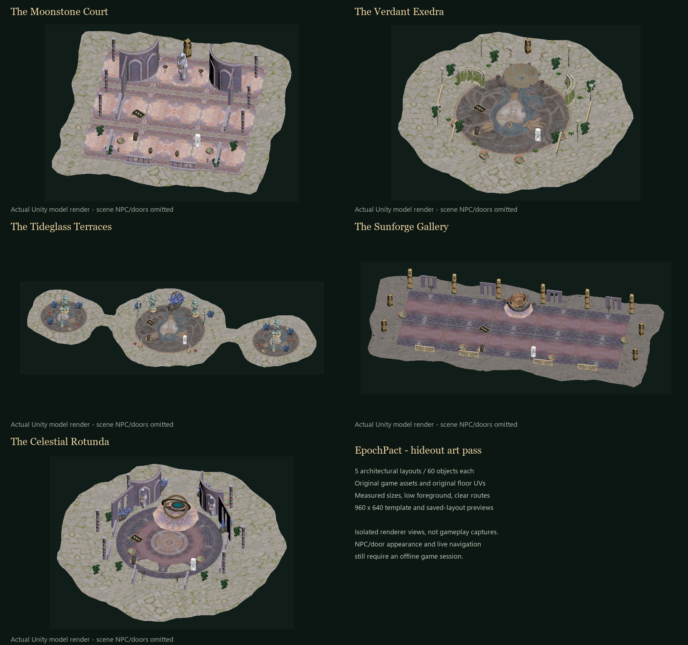

# Hideout art redesign — dev.64

Five built-in layouts have been rebuilt from inspected, exact catalog assets. This is a local design/test build; it has not been published. The installed loader is the normal player build, with all private art fixtures excluded. The game is closed. Personal hideout layouts, named templates and real preferences were not replaced. Choose a new design from **F6 → Hideout → Templates** and confirm Apply to see it.

## Actual visual evidence

These are actual isolated Unity renderer photographs, not AI mockups and not gameplay captures. The Login scene cannot provide 13 functional portal models or the scene vendor, so all five evidence images explicitly omit those 14 scene-sourced objects. Cache material appearance, native gate rotation/occlusion, live lighting and full navigation still need a real offline-character test. The remaining static geometry was rendered.

139 unique model candidates were inspected through 140 completed render requests (83 + 45 + 12). White placeholders, sparse isolated leaves/roots, and misleadingly named partial objects were rejected for the authored layouts. The curated catalog contains 50 models with exact IDs and measured bounds.

## Changes

- Each layout has 60 objects: 16 functional stations/portals and 44 decorations. Repetitive portal pads were replaced with coherent architectural elements.
- The Moonstone Court: continuous violet-marble paving, vaulted apses, matching columns and rails, a guardian focal statue, low planted service court.
- The Verdant Exedra: a stepped native fountain, blue/gold mosaic, garden pergolas, planted bowls, small flowers and low border rails.
- The Tideglass Terraces: three mosaic-paved islands, blue/gold temple columns, coral groupings, two open causeways and split portal courts. The walkway prefab was replaced after it was not visibly effective in the composed render.
- The Sunforge Gallery: continuous marble gallery floor, warm carved colonnade, rear arcade, bronze native forge and ordered workshop bays.
- The Celestial Rotunda: circular marble court, brass orrery, guardian statues, vaulted crystal alcoves and curved foreground rails.
- Thick floor meshes are inlaid using measured height so their top surfaces sit .04–.085 units above ground; original floor UVs are preserved.
- Built-in and saved-template pictures are now 960×640; model cards remain 480×320. Cache-v4 rejects old version, incorrect dimensions and truncated data.
- The editor/history/selection/input/interaction code and proxy loader behavior were preserved. New art commands are EPOCHPACT_TESTING-only and absent from the player binary.

## Verification actually completed

- Full normal player build succeeded; version resource and stamped loader/core hashes validated.
- 35 Python tests passed: 9 catalog/design/geometry tests plus existing assets, packaging, isolated-session and capture tests.
- 27 freshly built argument-free native test programs passed, including hideout/history/tools and previous gameplay rules. The parameterized localization fixture is not counted as an argument-free test.
- All five final compositions rendered in the isolated game renderer.
- Six real renderer/cache checks passed: GPU eviction/disk load, wrong dimensions, old version, truncated file, read-only named-layout rendering, unchanged model-card dimensions.
- Player binary string checks confirm private art/edit fixtures are absent. Embedded final designs JSON matches source byte-for-byte.
- The ZIP contains exactly 8 allowlisted entries, only version.dll as runtime, with matching archived bytes and SHA-256 records. No test executable, SDK, log, save, game model or rendered game asset is distributed.

| Design | Objects | Outside anchors/envelopes | Min gate separation | Min planned approach |
|---|---:|---:|---:|---:|
| The Moonstone Court | 60 | 0 | 8.0 | 4.14 |
| The Verdant Exedra | 60 | 0 | 11.388 | 3.21 |
| The Tideglass Terraces | 60 | 0 | 8.0 | 3.0 |
| The Sunforge Gallery | 60 | 0 | 9.0 | 5.49 |
| The Celestial Rotunda | 60 | 0 | 11.388 | 3.58 |

Distances are game units. Decorative envelopes include 1.5 units for the irregular edge; approach planning uses a .75-unit grid and conservative circular renderer bounds. This is not a native collider or NavMesh certificate. Both island causeways retain the 6-unit nominal width (3 after conservative edge allowances).

## Not verified / failing game-session outcomes

The game currently remains at Login with LE-52/cycle-status exceptions despite the offline launch parameter. The normal offline action and a real menu click did not enter an offline character. No offline/save/player gates were removed to force entry. Private art review renders only script-free copies in a remote preview scene; it neither loads nor changes a player/world layout.

Therefore the new geometry has NOT passed live station/gate walking, native NavMesh audit, interaction/occlusion, current F6 editing/history regression or a normal player close/restart test. Previous dev63 results describe the previous layouts only and must not be cited as verification of these new ones.

Login test sessions 45, 47, 48, 49, 50 and 51 ended with **0xC0000005** on close. Session 47 had no GUI automation and no completed model render; the cause is not established. Session 46 did not launch a game. These are failures/unrun checks, not passing shutdown results. All owned sessions were restored; after each launched session the original 68 save files were byte-verified, the previous runtime restored and real preferences unchanged. The final local install then intentionally replaced only version.dll with the normal dev64 player loader, keeping a byte-verified dev63 backup.

## Artifacts and recovery

- Installed DLL: `C:\Program Files (x86)\Steam\steamapps\common\Last Epoch\version.dll`
- Installed DLL SHA-256: `4737635210cb2f1aee25a534fa722c9ac3721bd9c92f8abf06c0046147a1202c`
- Previous DLL backup: `C:\Users\falor\EpochPactLab\backups\hideout-dev64-before-install\version.dll`
- ZIP: `dist/hideout-dev64/EpochPact-0.1.2-dev.64-InGame.zip`
- ZIP SHA-256: `fbd0278a89909e13dff4cc126a6da9b5571cfa8425c862e05cb0e7a9bcec1005`
- Native results: `research/hideout-native-dev64-final.json`.
- Python results: `research/hideout-python-dev64-final.log`.
- Actual final render/cache evidence: `research/hideout-art-2026-11-08/composition-51`.
- Per-model inspection: `research/hideout-art-2026-11-08/asset-review-48`.
- Original source backup: `../backups/hideout-dev63-before-art-redesign`.
- Numeric seven-column placement exports and planning diagrams are beside this report.

Preferred design: **The Moonstone Court**. Its floor, columns and vaulted walls share a recognizable material family and the central statue creates a clear arrival view.
