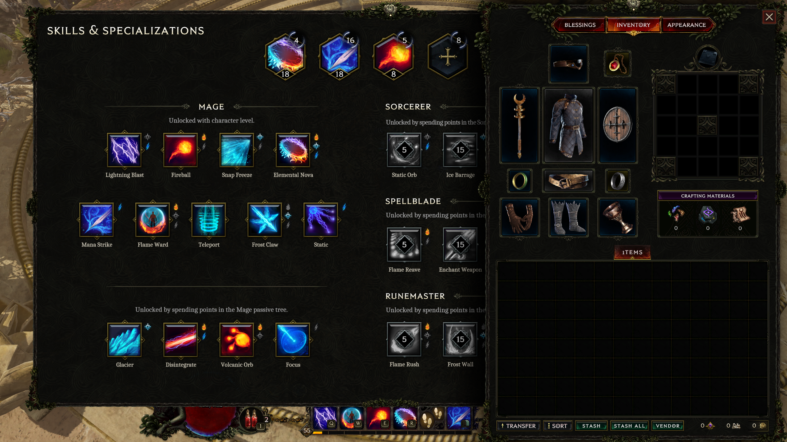

# Inventory footer validation — 0.1.2-dev.12

The floating left-side shortcut strip was replaced with a horizontal row in the
native inventory footer, after Transfer/Sort and before the visible currency
counters. The placement uses actual native RectTransforms in inventory canvas
coordinates. It measures visible currency children, since their larger layout
container includes intentionally unused space. No screen-coordinate fallback
places buttons outside the inventory.

The row uses normal-width buttons when space permits and a bounded compact
layout when needed. Unsupported or exceptionally narrow layouts hide it; the
app's Inventory page stays available. Placement updates only when its rectangle
changes, rather than dirtying the canvas every scan. Newly cached footer/currency
handles are released alongside the inventory handles during cleanup.

## Evidence

| Check | Result and scope |
|---|---|
| Placement rules | 120 scale/window/translation/currency combinations passed, including compact, impossible, non-finite and invalid-height layouts. All visible buttons stay inside the footer/menu/screen and clear native controls, currencies and one another. |
| Native regression suite | 17 programs passed. Placement is one of these programs; 120 is its case count, not another suite. |
| Python / JavaScript | 235 Python tests and 118 JavaScript tests passed. |
| Compiled player EXE | 21 package, startup, isolated install/update and HTTP checks passed on the final EXE. They include read-only source DLLs, custom Unicode folders, foreign loaders, unsupported builds, API ownership and no startup mutation. |
| Extracted ZIP connection | Four compound frozen-EXE checks passed with the production IPC parser and a native game-data simulator: stale read-only protocol announcement, slow independent reads, process restart, mismatched core and current UI resources. This is not live gameplay evidence. |
| Actual Last Epoch inventory | In a separate EpFeedbackTest save copy, real initialized native UISubScaler methods exercised 75%, 100%, 125% and 150%. All three shortcuts stayed inside the footer without overlapping native controls or currency rectangles. This is a native layout fixture, not manual settings-menu certification. |
| Simultaneous panels | Skills/Specializations and Passives were opened beside Inventory; the row stayed in the inventory footer. |
| Visibility and labels | Closing Inventory and selecting Blessings hid all owned shortcuts. Labels stayed Stash / Stash all / Vendor after delayed native label updates. |
| Native button callbacks | Stash and Vendor each opened then closed their respective panels. The Stash all callback completed against an empty inventory. Non-empty transfers were not re-tested in this pass; earlier evidence is retained separately. |
| Final production core + desktop EXE | Matching final player core connected to the loaded offline test character. Stash/Vendor opened and closed through the compiled serial API. XP x2 applied. Normal app close returned code 0; a subsequent native read showed `xp: x1, hook out` while the game was still running. |
| Full game close | The final production-core session ended with **0xC0000005**, UnityPlayer.dll + **0x109ad1**. This known intermittent issue remains unresolved. Earlier test-core sessions closed with code 0; those do not override the final production shutdown result. |
| Save restoration | All **54 original save files** were restored and verified byte-for-byte. Three test files were archived. Originals were not used for modification tests. |
| Security scan | Microsoft Defender signature **1.459.676.0**, antivirus and real-time protection enabled, reported no threats in the final EXE, final core DLL and final ZIP. No protection exclusions were added. This does not imply VirusTotal, browser, vendor or Nexus clearance. |

Earlier test-driver requests incorrectly supplied internal `save_id`, then supplied
ownership outside `args`; both were refused before mutation. A final close check
initially asserted the wrong spelling `xp=1`; its raw native reply already showed
`xp: x1, hook out`. The harness was corrected and the raw evidence retained. These
harness failures are not counted as passing product tests.

Actual game screenshot, using the corrected shared native placement code in the
isolated test build:

## Final player artifact

| File | SHA-256 |
|---|---|
| EpochPact-0.1.2-dev.12.zip | `79e8fd0d9b10739a452cd54677bf633fd22ca1955e0658bb1b13779c65105642` |
| EpochPact.exe | `5ea16e27cc9d94a0f8c9b18105765d449d38260536e5e243465b969a961b878a` |
| EpochPact.Core.dll | `a51e3b71f5b5748440312385333345f70a5e14f52605f41dae9a01616cd3bda0` |
| version.dll | `72cbb3a0dbc43b4864d08042c3d317577076d812af11ad82653884c0f403abd4` |

The final ZIP is **26,890,666 bytes**, contains 849 entries and is verified against
its manifest (775 runtime-file entries). Manual native DLLs match the app's bundled
DLLs exactly. The required EXE CLR config remains beside the EXE. No testhost,
testing core, SDK, private logs, save files or game binaries are distributed.

[Machine-readable results](inventory-footer-validation-2026-10-12.json).
Private detailed logs and receipts remain under the ignored research/live directory.
The production artifact was rebuilt after adding footer/currency cleanup; the
earlier candidate ZIP is not the release artifact.
